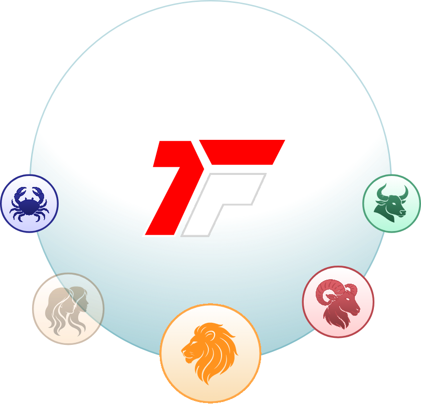
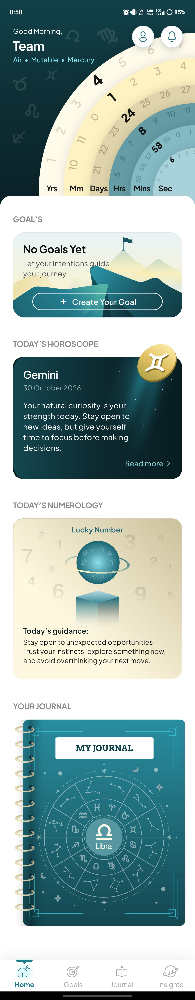
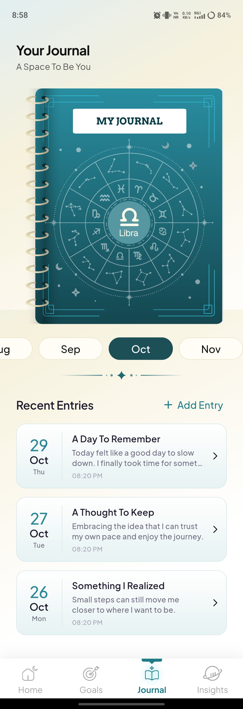
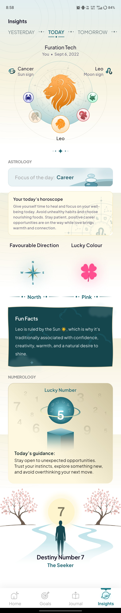
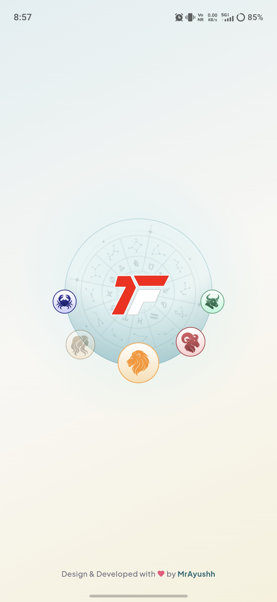
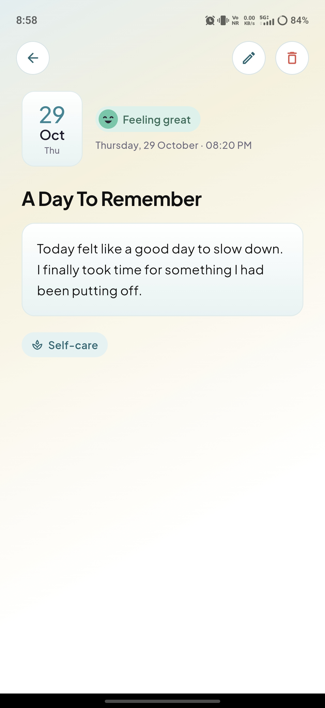
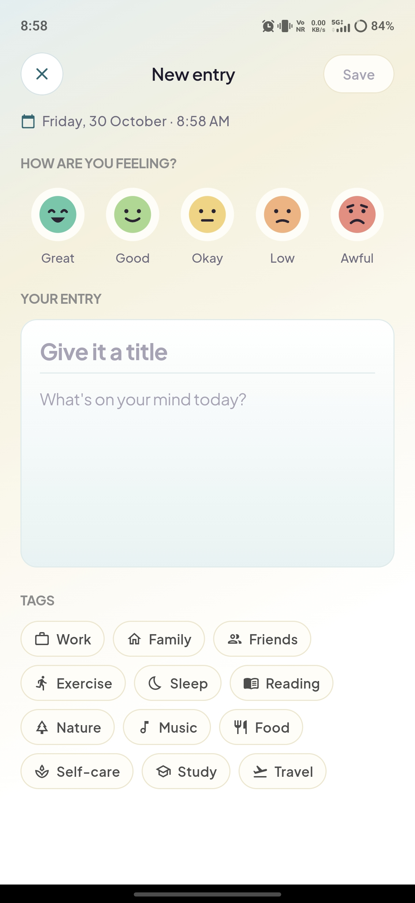
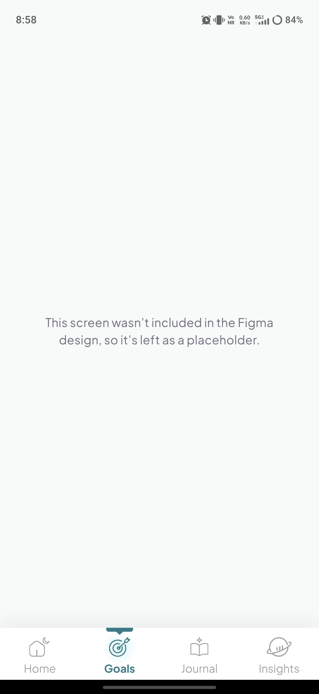

<p align="center">
  
</p>

<h1 align="center">FTastro</h1>

<p align="center">
  Flutter UI assignment: <b>Home</b>, <b>Journal</b> and <b>Insights</b> screens built from the supplied Figma file, plus a splash screen.<br/>
  Clean Architecture, BLoC/Cubit, mock data only (no backend).
</p>

<p align="center">
  
  
  
  
</p>

## Screenshots

<table align="center">
  <tr>
    <th>Home</th>
    <th>Journal</th>
    <th>Insights</th>
  </tr>
  <tr>
    <td></td>
    <td></td>
    <td></td>
  </tr>
</table>

<table align="center">
  <tr>
    <th>Splash</th>
    <th>Entry detail</th>
    <th>New entry</th>
    <th>Goals</th>
  </tr>
  <tr>
    <td></td>
    <td></td>
    <td></td>
    <td></td>
  </tr>
</table>

## Screen recording

<p align="center">
  <a href="documentation/recording/screen-recording.mp4">
    
  </a>
  <br/>
  <a href="documentation/recording/screen-recording.mp4"><b>▶ Watch the screen recording</b></a>
  <br/>
  Navigation, interactions and animations across all screens.
</p>

## Versions

- Flutter **3.24.0** (stable)
- Dart **3.5.0**

[//]: # (- Android: tested on an Android 16 emulator &#40;1080x2424&#41; and an Android phone)
[//]: # (- iOS: deployment target 15.0 &#40;newer Xcode versions don't support 12.0, the `flutter create` default&#41;)

## Setup and run

```bash
git clone https://github.com/Mr-Ayushh/ft_astro_test.git
cd ft_astro_test
flutter pub get
flutter run
```

For release build:

```bash
flutter run --release

or 

flutter build apk --release --split-per-abi
```

No API keys, env files or code generation. Fonts, the logo and all Figma illustrations are bundled in `assets/`, so the app works offline.

App icons are generated from `assets/icon/` with `dart run flutter_launcher_icons`.

## Packages

| Package | Why |
|---------|-----|
| `flutter_bloc` | Bloc/Cubit state management |
| `equatable` | Value equality for states, events and entities |
| `animations` | `OpenContainer` container transform (entry tile to detail, "Add Entry" to editor) |
| `flutter_svg` | Figma SVG exports (illustrations, icons, logo) |
| `intl` | Date formatting |
| `flutter_launcher_icons` (dev) | Generates the Android/iOS app icons |
| `flutter_lints` (dev) | Lint rules |

## Project structure

```
lib/
├── main.dart                # system UI setup, preloads the logo, runApp
├── app.dart                 # composition root: repositories, JournalBloc, MaterialApp
├── core/                    # constants, date formatting, theme, utils, shared widgets
└── features/
    ├── splash/              # splash screen
    ├── shell/               # bottom navigation and tabs
    ├── home/                # domain / data / presentation
    ├── journal/             # domain / data / presentation
    ├── insights/            # domain / data / presentation
    └── goals/               # placeholder tab (not in the Figma file)
```

Every folder layer has an `index.dart` barrel, and imports go through them (`package:ftastro/core/index.dart`, `package:ftastro/features/journal/domain/index.dart`, ...).

## Architecture

Each feature is split into **domain** (entities, repository contracts, use cases, plain Dart), **data** (mock data sources and repository implementations) and **presentation** (blocs/cubits, pages, widgets). Presentation never imports data; `app.dart` is the only place where the two are wired together with `RepositoryProvider`.

| Class | Type | Handles |
|-------|------|---------|
| `NavigationCubit` | Cubit | Selected bottom tab, Android back goes to Home before closing |
| `HomeCubit` | Cubit | Profile, today's horoscope, numerology, goals |
| `AgeClockCubit` | Cubit | Recalculates the age dial every second |
| `JournalBloc` | Bloc | Entries stream, month selection, delete + undo |
| `EntryEditorCubit` | Cubit | New/edit entry form and save |
| `InsightsCubit` | Cubit | Birth chart and the insight for the selected period |

`JournalBloc` is a Bloc because the journal handles several separate user events (month selection, delete, undo) on top of a stream of entries from the repository. The rest are simple call-to-state flows, so they are Cubits.

Layers, events, states and data flow are explained in [`documentation/ARCHITECTURE.md`](documentation/ARCHITECTURE.md).


[//]: # ()
[//]: # (## Animations and interactions)

[//]: # ()
[//]: # (- **Launch:** Android's launch screen shows the logo on the same off-white, then the Flutter splash grows the logo into place while the gradient, glow and a slowly turning zodiac wheel fade in. After 3 seconds it fades into Home.)

[//]: # (- **Age dial &#40;Home&#41;:** six rings drawn with a `CustomPainter`. They sweep in from left to right on open and then follow the clock; the seconds ring turns every second.)

[//]: # (- **Journal cover &#40;Home&#41;:** slide it to the left or tap it and it swings open on its spiral, showing the recent entries inside, then the Journal tab opens.)

[//]: # (- **Bottom nav:** sliding indicator with glow; tabs keep their scroll position, and animations in hidden tabs pause.)

[//]: # (- **Journal:** month pills animate and the selected month scrolls to the centre; entries fade in one after another; tiles open the detail page with a container transform; swipe left to delete with undo.)

[//]: # (- **Insights:** zodiac wheel turns inside the profile circle; period tabs switch with an underline animation and the content cross-fades; the lucky colour clover is re-tinted per period.)