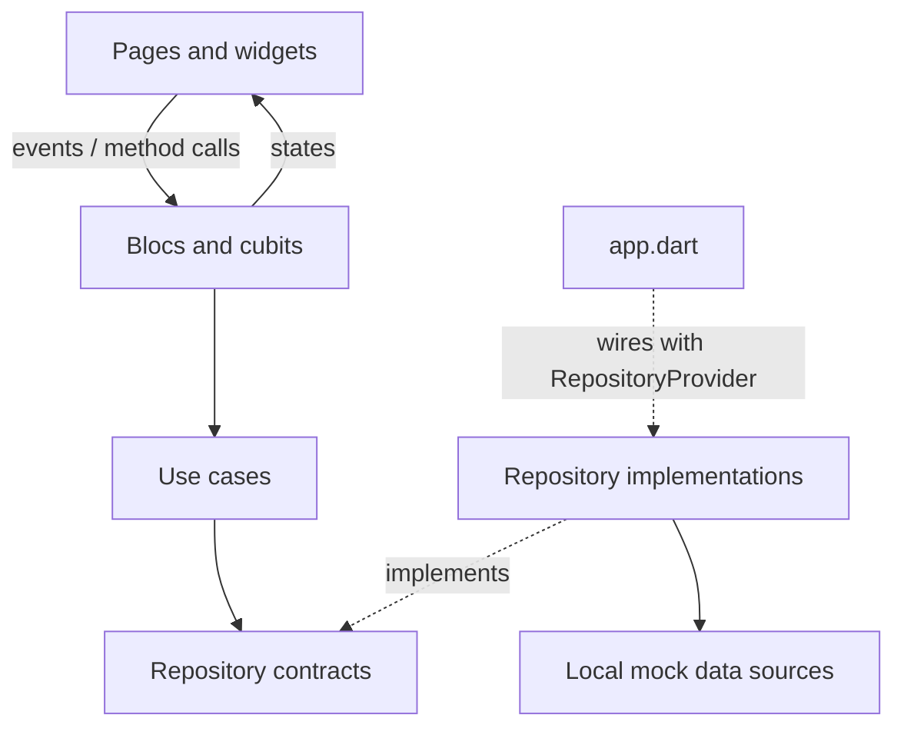
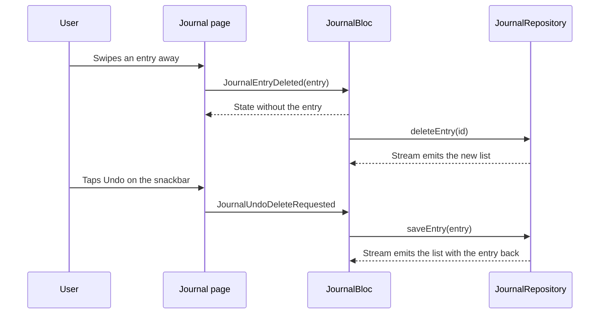

# FTastro – Architecture and BLoC/Cubit

## Layers

The app uses feature-first Clean Architecture. Each feature folder has up to three layers:

| Layer | Contains | May import |
|-------|----------|------------|
| `domain/` | Entities, repository contracts, use cases | Plain Dart only, plus other domain barrels |
| `data/` | Local (mock) data sources, models, repository implementations | Its own `domain` |
| `presentation/` | Blocs/cubits, pages, widgets | `core`, `domain` and other presentation barrels, never `data` |

```
lib/
├── main.dart
├── app.dart                 # composition root
├── core/
│   ├── constants/           # app name, asset paths, splash duration
│   ├── extensions/          # date formatting
│   ├── theme/               # colours, text styles, spacing, ThemeData
│   ├── utils/               # responsive helpers, bloc observer
│   └── widgets/             # shared widgets (numerology card, ornament divider, fade-in...)
└── features/
    ├── splash/presentation/
    ├── shell/presentation/  # MainShell, bottom nav, NavigationCubit
    ├── home/{domain,data,presentation}
    ├── journal/{domain,data,presentation}
    ├── insights/{domain,data,presentation}
    └── goals/presentation/  # placeholder
```

Every layer folder has an `index.dart` barrel and all imports go through them.



## Composition root

`app.dart` creates the repositories and the app-level `JournalBloc`:

```dart
MultiRepositoryProvider(
  providers: [
    RepositoryProvider<JournalRepository>(
      create: (_) => JournalRepositoryImpl(JournalLocalDataSourceImpl()),
    ),
    RepositoryProvider<InsightsRepository>(
      create: (_) => const InsightsRepositoryImpl(InsightsLocalDataSourceImpl()),
    ),
    RepositoryProvider<HomeRepository>(
      create: (_) => const HomeRepositoryImpl(HomeLocalDataSourceImpl()),
    ),
  ],
  child: BlocProvider(
    create: (context) => JournalBloc(...)..add(const JournalSubscriptionRequested()),
    child: MaterialApp(...),
  ),
)
```

`JournalBloc` sits above `MaterialApp` because the entry detail and editor routes need it, as well as the journal cover on Home. The other cubits are created in `MainShell`, or in `HomePage` for the age clock.

No service locator is used; with three repositories `RepositoryProvider` is enough.

## Use cases

| Feature | Use cases |
|---------|-----------|
| Home | `GetUserProfile`, `GetDailyHoroscope`, `GetNumerology`, `GetGoals`, `CalculateAge` |
| Journal | `WatchJournalEntries`, `SaveJournalEntry`, `DeleteJournalEntry` |
| Insights | `GetBirthChart`, `GetAstroInsight` |

`CalculateAge` is pure calculation: it splits the time since a date into years, months, days, hours, minutes and seconds, borrowing from the bigger unit when needed.

## Bloc or Cubit

`JournalBloc` is a **Bloc** because the journal reacts to several independent user events (month selection, delete, undo) on top of a data stream, and having them as event classes keeps them easy to trace. Everything else is a straightforward call → new state, so those are **Cubits**. The splash timer is local UI state and stays in a `StatefulWidget`.

### JournalBloc

`lib/features/journal/presentation/bloc/journal_bloc.dart`

| Event | What happens |
|-------|--------------|
| `JournalSubscriptionRequested` | Listens to `WatchJournalEntries` with `emit.forEach`; every repository change becomes a new state |
| `JournalMonthSelected` | Changes the selected month |
| `JournalEntryDeleted` | Removes the entry from the state synchronously (needed by `Dismissible`), keeps it in `lastDeleted` and deletes it in the repository |
| `JournalUndoDeleteRequested` | Saves `lastDeleted` back |

`JournalState` holds `status`, `entries` (newest first), `months` (last 11 months, the current one and the next), `selectedMonth` and `lastDeleted`. `visibleEntries` is a getter that filters by the selected month, so the list can't get out of sync with the selection.

### Cubits

| Cubit | State | Notes |
|-------|-------|-------|
| `NavigationCubit` | `AppTab` (`home`, `goals`, `journal`, `insights`) | Used by the bottom nav, "Create Your Goal", "Read more" and the journal cover. `PopScope` sends Android back to Home before closing the app |
| `HomeCubit` | `HomeState`: `status`, `user`, `horoscope`, `numerology`, `goals` | `load()` fetches everything for today |
| `AgeClockCubit` | `AgeBreakdown` | A `Stream.periodic` ticks every second and runs `CalculateAge` from the birth date (6 September 2022) |
| `EntryEditorCubit` | `EntryEditorState`: mood, title, body, tags, `status` | `canSave` needs a mood and a title or text; `save()` goes through `SaveJournalEntry` and works for new and edited entries |
| `InsightsCubit` | `InsightsState`: `status`, `period`, `chart`, `insight` | `load()` gets the birth chart and today's insight; `periodSelected()` switches the tab at once and loads the insight for that period |

## Data flow

`JournalRepositoryImpl` keeps the entries in memory and exposes them as a broadcast stream. Saving or deleting an entry pushes a new list, and `JournalBloc` turns it into a new state. The Journal tab, the entry detail page and the inside of the journal cover on Home all read from that one state.



## Performance notes

- The age dial is split into two layers: rings and labels are drawn once and cached, and only the numbers repaint while the rings turn.
- The journal cover sits on its own `RepaintBoundary`, so the 3D swing doesn't repaint the cover art.
- Tabs live in an `IndexedStack`, so they keep their state and scroll position; hidden tabs are wrapped in `TickerMode(enabled: false)`, so their animations (like the Insights wheel) don't run off screen.
- Large SVGs and images are preloaded during the splash, and the logo before the first frame, so the first visit to a tab doesn't stutter.
